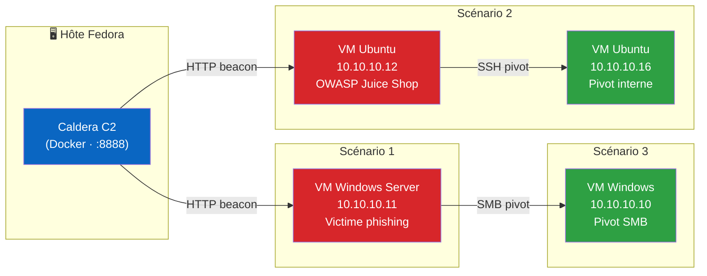
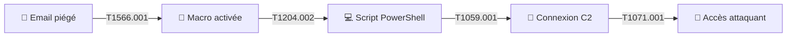
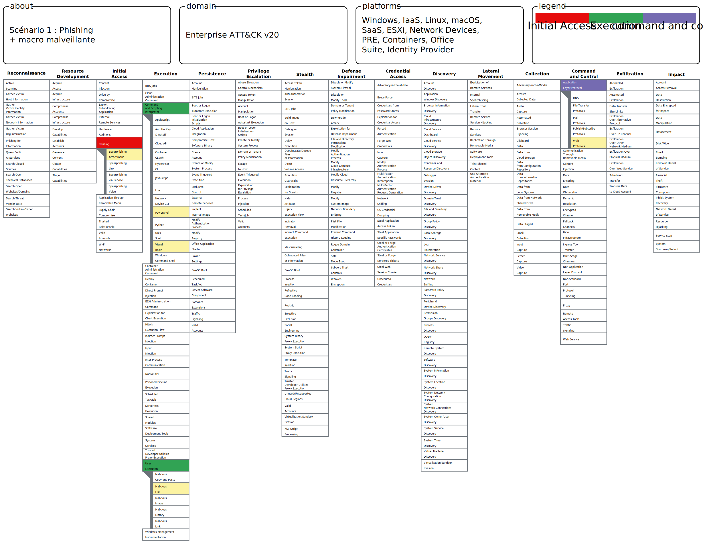
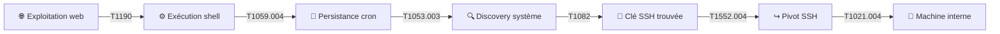
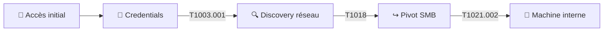
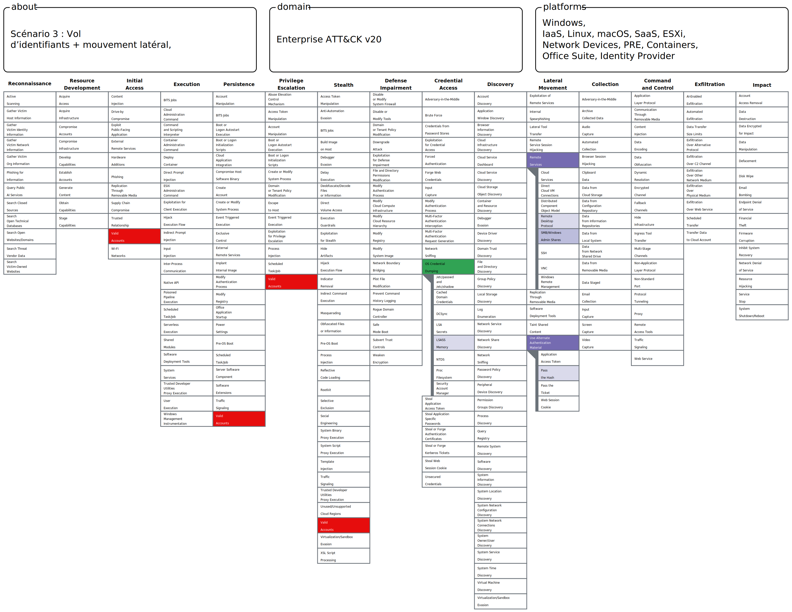

<div align="center">

# 🛡️ Adversary Emulation Lab — Caldera × MITRE ATT&CK

**Émulation d'adversaire multi-scénarios sur environnement isolé, cartographiée sur MITRE ATT&CK**

[](https://attack.mitre.org/)
[](https://github.com/mitre/caldera)
[]()
[]()
[]()

*Phishing · Exploitation web · Vol d'identifiants & mouvement latéral*

</div>

---

## 📌 Résumé

Ce dépôt documente la mise en œuvre pratique de **trois chaînes d'attaque complètes**, exécutées de bout en bout dans un laboratoire virtualisé isolé à l'aide de la plateforme d'émulation d'adversaire [Caldera](https://github.com/mitre/caldera) (MITRE), puis cartographiées sur le référentiel [MITRE ATT&CK](https://attack.mitre.org/).

L'objectif n'était pas de suivre un tutoriel, mais de **déployer réellement** des agents sur des machines Windows et Linux, **diagnostiquer et résoudre** les blocages rencontrés (EDR, restrictions système, erreurs de configuration), puis produire une documentation technique exploitable — à la manière d'un rapport de purple team.

> 🎓 Projet réalisé dans un cadre pédagogique. Voir [Avertissement](#️-avertissement).

---

## 🧭 Sommaire

| | |
|---|---|
| [🗺️ Architecture du lab](#️-architecture-du-lab) | [🥇 Scénario 1 — Phishing](#-scénario-1--phishing--macro-malveillante) |
| [📊 Couverture ATT&CK](#-couverture-attck-globale) | [🥈 Scénario 2 — Serveur web](#-scénario-2--compromission-dun-serveur-web) |
| [🧩 Problèmes & résolutions](#-problèmes-rencontrés--résolutions) | [🥉 Scénario 3 — Vol d'identifiants](#-scénario-3--vol-didentifiants--mouvement-latéral) |
| [📁 Structure du dépôt](#-structure-du-dépôt) | [⚠️ Avertissement](#️-avertissement) |

---

## 🗺️ Architecture du lab



Réseau **host-only** VirtualBox (`10.10.10.0/24`), entièrement isolé d'Internet côté cibles. Caldera tourne en conteneur Docker sur l'hôte.

| Rôle | Machine | OS | IP |
|---|---|---|---|
| Serveur C2 | Hôte | Fedora | `10.10.10.1` |
| Victime phishing | VM 1 | Windows Server | `10.10.10.11` |
| Serveur web vulnérable | VM 2 | Ubuntu 22.04 | `10.10.10.12` |
| Pivot interne (Linux) | VM 3 | Ubuntu 22.04 | `10.10.10.16` |
| Pivot interne (Windows) | VM 4 | Windows Server | `10.10.10.10` |

---

## 📊 Couverture ATT&CK globale

| Tactique | Technique | Scénario | Statut |
|---|---|---|:---:|
| Initial Access | T1566.001 — Spearphishing Attachment | 1 | ✅ |
| Initial Access | T1190 — Exploit Public-Facing Application | 2 | ✅ |
| Execution | T1204.002 — User Execution: Malicious File | 1 | ✅ |
| Execution | T1059.001 — PowerShell | 1 | ✅ |
| Execution | T1059.004 — Unix Shell | 2 | ✅ |
| Persistence | T1053.003 — Scheduled Task/Job: Cron | 2 | ✅ |
| Discovery | T1082 — System Information Discovery | 2 | ✅ |
| Discovery | T1018 — Remote System Discovery | 3 | ✅ |
| Credential Access | T1552.004 — Unsecured Credentials: Private Keys | 2 | ✅ |
| Credential Access | T1003.001 — OS Credential Dumping: LSASS Memory | 3 | ✅ |
| Lateral Movement | T1021.004 — Remote Services: SSH | 2 | ✅ |
| Lateral Movement | T1021.002 — Remote Services: SMB | 3 | ✅ |
| Command & Control | T1071.001 — Application Layer Protocol | 1 | ✅ |

**13 techniques** · **3 chaînes d'attaque** · **2 systèmes d'exploitation** (Windows / Linux) · **Mouvement latéral réel démontré** sur 2 scénarios (pas uniquement documenté en théorie)

---

## 🥇 Scénario 1 — Phishing + macro malveillante

<details>
<summary><b>Email → macro Word → PowerShell → C2</b> (cliquer pour déplier)</summary>



| Étape | Tactique | Technique |
|---|---|---|
| Email piégé | Initial Access | `T1566.001` |
| Activation macro | Execution | `T1204.002` |
| Script PowerShell | Execution | `T1059.001` |
| Connexion C2 | Command and Control | `T1071.001` |

**🗺️ Navigator layer :**



</details>

---

## 🥈 Scénario 2 — Compromission d'un serveur web

<details>
<summary><b>Exploitation web → persistance → pivot SSH</b> (cliquer pour déplier)</summary>

**Cible** : [OWASP Juice Shop](https://owasp.org/www-project-juice-shop/) (application volontairement vulnérable)



| Étape | Tactique | Technique |
|---|---|---|
| Exploitation faille web | Initial Access | `T1190` |
| Exécution de commandes | Execution | `T1059.004` |
| Persistance (cron) | Persistence | `T1053.003` |
| Reconnaissance système | Discovery | `T1082` |
| Clé SSH exploitée | Credential Access | `T1552.004` |
| Pivot vers machine interne | Lateral Movement | `T1021.004` |

**🗺️ Navigator layer :**


</details>

---

## 🥉 Scénario 3 — Vol d'identifiants + mouvement latéral

<details>
<summary><b>Credentials → discovery réseau → pivot SMB</b> (cliquer pour déplier)</summary>



| Étape | Tactique | Technique |
|---|---|---|
| Accès initial | Initial Access | *(réutilisation scénario 1)* |
| Récupération credentials | Credential Access | `T1003.001` |
| Reconnaissance réseau | Discovery | `T1018` |
| Connexion via SMB | Lateral Movement | `T1021.002` |

**🗺️ Navigator layer :**



</details>

---

## 🧩 Problèmes rencontrés & résolutions

> C'est la partie la plus formatrice de ce lab : aucun scénario ne s'est déroulé sans accroc. Documenter ces blocages — et pas seulement le résultat final — est volontaire.

| # | Problème | Scénario | Cause racine | Résolution |
|---|---|---|---|---|
| 1 | Agent bloqué au déploiement | 1 | Windows Defender détecte la signature du binaire Sandcat | Désactivation temporaire de la protection temps réel (lab isolé) |
| 2 | Fichier introuvable après écriture | 1 | Paramètre `implant_name` non appliqué côté serveur | Inspection de l'en-tête HTTP `Content-Disposition` pour retrouver le vrai nom généré |
| 3 | Commande PowerShell introuvable | 1 | `pwsh` (PS Core) non installé par défaut sur Windows Server | Remplacement par `powershell` (PS 5.1 natif) |
| 4 | Opération sans aucune décision exécutée | 1 | Ability ajoutée mais jamais réellement persistée dans le profil | Vérification systématique de la section *Ordering* avant tout lancement |
| 5 | Perte totale des agents et profils | 2 | Redémarrage du daemon Docker Desktop → conteneur réinitialisé | Reconstruction de l'environnement ; leçon sur la persistance des volumes Docker |
| 6 | `Access is denied` (erreur système 5) sur SMB | 3 | `UAC Remote Restriction` bloque l'auth distante des comptes locaux non-admin intégré | Modification de la clé de registre `LocalAccountTokenFilterPolicy` |

---

## 📁 Structure du dépôt

```
.
├── README.md
├── mapping/                 # Cartographie MITRE ATT&CK Navigator (captures)
│   ├── scenario1_navigator.png
│   ├── scenario2_navigator.png
│   └── scenario3_navigator.png
└── operations/              # Preuves d'exécution (captures Caldera : agents, profils, résultats)
    ├── scenario1/
    ├── scenario2/
    └── scenario3/
```

> Les commandes de ce README sont présentées avec des valeurs d'exemple (IPs, identifiants) plutôt que les valeurs réelles du lab, pour éviter d'exposer des informations spécifiques à l'environnement de test.

---

## 🛠️ Stack technique


---

## ⚠️ Avertissement

Ce dépôt documente un exercice réalisé exclusivement dans un environnement de laboratoire isolé (réseau host-only, aucune machine exposée à Internet), à des fins pédagogiques. Aucune des techniques présentées n'a été employée contre un système tiers sans autorisation.

**Toute utilisation de ces techniques contre des systèmes que vous ne possédez pas ou n'êtes pas explicitement autorisé(e) à tester est illégale.**

Les identifiants et mots de passe visibles dans les commandes sont des valeurs de laboratoire jetables, sans rapport avec un système réel.

---

<div align="center">

*Construit avec Caldera (MITRE) · Cartographié sur MITRE ATT&CK*

</div>
